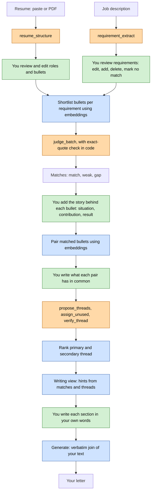

# Job-Friend

A local app that helps you write your own cover letter. The model never writes letter text.

<!-- Screenshots: add here once available. -->

## Setup

Tested from a fresh clone. Needs Python 3.11+, Node.js, and [LM Studio](https://lmstudio.ai/) running
locally with a chat model and an embedding model loaded (see Running it locally below for the default
model names). See Run it below for Windows PowerShell commands, the start scripts, and single-process
mode.

```bash
cd backend
python -m venv .venv && source .venv/bin/activate
pip install -e ".[dev]"
uvicorn app.main:app --port 8001
```

```bash
cd frontend
npm install
npm run dev
```

Open `http://localhost:5173` (the default Vite port; add `-- --port 5500` to `npm run dev` to match the
start scripts and the rest of this README instead).

## Why I built this

I had made cover letters before and I was unsatisfied with the output, could not get the exact reason. I revisited the letters and still felt the same. After reviewing them I thought the problem was that the input was only the resume. I wanted to get more out of the users in a cover letter.

## What it does

Turns a resume into a reviewable inventory of experience units, matches the requirements of a job
description against that inventory with cited evidence (match, weak, or gap), and gives you the
pieces to write your own cover letter from: matched-requirement pointers, recurring evidence grouped
into threads, and an honest list of what your inventory does not cover. The app never writes the
letter. Every sentence in the final letter is typed by you.

## Principles

- No generated prose. The model never writes letter text; every model output is structured data
  (requirements, verdicts, quotes, thread ideas) that you review before it is used anywhere.
- Model proposes, you review. Every extraction and verdict is editable before anything downstream
  depends on it.
- No fabrication. A judge or thread verdict can only cite a quote that appears verbatim in the
  candidate unit text itself; code checks this, not the model (see Verbatim quote checking below).
- Gaps are normal. A requirement with no match is a valid, expected result, not an error.
- Everything local. By default the app makes no network calls except to the local LM Studio server (see Running it locally).

## How it works

Six steps call a chat model; everything else is plain code.



Orange: chat model call. Blue: plain code. Green: you.

- Resume import: `resume_structure` turns a pasted or uploaded resume into roles and bullets
  ("units"). You review and edit before anything is saved -- nothing is committed to your inventory
  automatically.
- JD submit: `requirement_extract` turns a job description into weighted requirements.
- Judging: a fixed twenty-minute window calls `judge_batch` in batches, matching shortlisted units
  against each requirement. Shortlisting (picking which units to show the judge) uses the embedding
  model, not a chat call. Whatever is still unjudged when the window closes is finished by hand.
- Pairs and statements: matched units are paired by code (embedding similarity, top-k per unit plus a
  global top-N, capped) -- no model call. You write, in your own words, what each pair has in common.
- Threads: `propose_threads` groups your statements into recurring ideas, `assign_unused` places any
  leftover statement into one of them, and `verify_thread` checks each thread against each of its
  units, asking for a supporting quote.
- Primary/secondary thread, the writing view, and Generate are all plain code: threads are ranked by
  code, never chosen by a model; the writing view assembles your matched/weak/gap requirements and the
  pointers your judgments already produced; Generate joins your own section texts verbatim, with
  nothing added, removed, or reworded.

A separate embedding model -- not one of the six steps above -- backs shortlisting for judging and
scoring for pairs. It never produces text, only vectors, and is never a chat call.

Known variation: at temperature 0, extracted content and section coverage are stable, but exact
wording and whether a compound line gets split into one requirement or several can vary between runs
and between prompt versions (see Limits below). The review step is where you correct wording and
splits/merges, the same as any other model proposal.

## Verbatim quote checking

Two tasks ask the model for a supporting quote, and both are checked the same way in code: the quote
is normalized (lowercased, whitespace collapsed) and must appear as a literal substring of the exact
text that was sent to the model for that candidate -- not a paraphrase, not something merely true of
the unit.

- Judging (`judge_batch`): a unit whose quote fails this check is dropped from the result entirely --
  its verdict becomes `none`, as if the model had never listed it. There is no partial credit for a
  quote that does not check out.
- Threads (`verify_thread`): a bad quote does not remove the unit from the thread. The unit stays,
  with whatever verdict the model gave, but no quote -- shown on the Threads screen as **(no verified
  quote)** next to that unit instead of a quote.

Judging failures come in three different sizes, not one:

- A bad quote (above) drops only that one (requirement, unit) match. Everything else in the
  requirement, and every other requirement in the same batch call, is unaffected.
- A hard error (an unknown unit id, a duplicate id, or an invalid verdict value) discards the whole
  result of the requirement: it stays `pending` with `last_error` set, and can be retried on its own with
  "Judge remaining" -- it does not affect other requirements in the same batch.
- A cancelled or timed-out call (the deadline of the window, Finish, or Back) writes nothing at all for
  that batch; whatever earlier batches already completed stays saved.

## Why the model does not write the letter

At the earlier stage, the resume is all that I have and this is not material enough to write the user story for a model. So I need to get the story out of the user. This is why I use enrichment and get each story of a matched unit. If I stitch all matched stories together it will not be coherent. That is why I have a section to bubble up the common threads in matched units of a user. Even after getting the central theme, user has to make a decision how the central theme exactly affects a story. Hence I use a letter view where these hints are given. Now the user can correlate the anecdotes with the central theme in his own way, by writing the letter.

## How it was built

I thought that stories would make a letter. So I thought probing the user for context, contribution, outcome was a fine way to get the story out of each resume unit. Also we needed a central thread binding the stories. Initially I had planned to have a section called style profile, which would have user essays as a way of getting the style of writing. But this proved to be too complex. So in the end probing the user was a way of getting a central theme. The user is asked for similarity between the matched units and then the LLM finds a common thread from them.
The app has two stages. First one until the resume was matched with requirements. Second one is probing for a central theme in the matches. I designed the solution and used an agent to code.

## Running it locally

[LM Studio](https://lmstudio.ai/) must be running locally with its OpenAI-compatible server on, and
two models loaded: a chat model (default `qwen/qwen3-8b`, i.e. Qwen3-8B Q4_K_M) and an embedding model
(default `text-embedding-nomic-embed-text-v2-moe`). Both names are settings (`backend/app/config.py`),
overridable via `JOB_FRIEND_`-prefixed environment variables -- load different models under the same
names, or change the names, to use something else.

Privacy: by default the only network calls the app (backend and frontend) makes are to the local LM
Studio server, set by `lm_studio_base_url` (default `http://localhost:1234/v1`). If you point that
setting at a remote host, the app will follow it. Resume text, job descriptions and everything you
write stay on the machine unless you do that. Models are downloaded by LM Studio, not by this app: the
start scripts call `lms load`, which downloads a model if it is not already cached. The `experiments/`
folder is not part of the app; one prototype there (`experiments/style`) downloads an embedding model
from Hugging Face the first time it runs.

## Measured timings

Observed on my own machine during development -- not guaranteed on other hardware.

- No-think calls generate at roughly four tokens per second, observed on my machine -- the main
  reason judging runs as a fixed window rather than "wait for every requirement."
- Extraction (`requirement_extract`, one call) typically takes seventy to two hundred thirty seconds,
  depending on the length of the JD.
- Judging runs inside a fixed twenty-minute window -- a constant in code (`JUDGING_WINDOW_MINUTES` in
  `backend/app/judging.py`), not a measurement. Observed full runs took about twelve to twenty-five
  minutes end to end; twenty minutes is the ceiling of the window, not a typical duration.
- Resume import (`resume_structure`, one call) took eighty-three to one hundred forty-three seconds,
  observed on my machine.

These vary with hardware, resume/JD length, and whatever else is loaded in LM Studio at the time.

## Demo files

`demo/` holds optional sample data for trying the app without your own: a fictional resume and a
fictional job description, both clearly invented. Nothing in that folder is read automatically --
import the resume through the Inventory screen and paste the JD into a job the normal way, same as
with your own data.

## Run it

First-time setup, then start the backend and frontend as two processes (or use the start scripts, which also start LM Studio and load both models):

### Windows (PowerShell)

- First-time setup:
  - `cd backend; python -m venv .venv; .venv\Scripts\Activate.ps1; pip install -e ".[dev]"`
  - `cd frontend; npm install`
  - Migrations run automatically the first time the backend starts (see Data and privacy below) -- no manual step.
- Using the start script (edits its model names/ports at the top of the file first): `powershell -ExecutionPolicy Bypass -File .\start_job_friend.ps1`, then open `http://localhost:5500`. Stop everything with `powershell -ExecutionPolicy Bypass -File .\start_job_friend.ps1 stop`.
- Manually, in two terminals:
  - Backend: `cd backend; .venv\Scripts\Activate.ps1; uvicorn app.main:app --port 8001`
  - Frontend (dev; proxies `/api` to the backend): `cd frontend; npm run dev -- --port 5500` -- then open `http://localhost:5500`.
  - Single process instead: `cd frontend; npm run build`, then run the backend as above -- it serves the built frontend from `frontend/build` with SPA fallback routing, so only `http://localhost:8001` is needed.

### bash

- First-time setup:
  - `cd backend && python -m venv .venv && source .venv/bin/activate && pip install -e ".[dev]"`
  - `cd frontend && npm install`
  - Migrations run automatically the first time the backend starts -- no manual step.
- Using the start script: `./start_job_friend.sh`, then open `http://localhost:5500`. Stop everything with `./start_job_friend.sh stop`.
- Manually, in two terminals:
  - Backend: `cd backend && source .venv/bin/activate && uvicorn app.main:app --port 8001`
  - Frontend: `cd frontend && npm run dev -- --port 5500` -- then open `http://localhost:5500`.
  - Single process instead: `cd frontend && npm run build`, then run the backend as above and open `http://localhost:8001`.

`logs/` holds `judging.log` (every judge and thread-discovery model call: tokens, timing, finish reason, and any error -- a rotating file, so old entries eventually drop off); the start scripts additionally write `lmstudio.log`, `backend.log`/`backend.err.log`, and `frontend.log`/`frontend.err.log` there.

## What the model does and does not do

Generated from the task definitions in `backend/app/llm/tasks.py`:

| Name | Input | Output | Thinking | Max tokens | Validated where |
| --- | --- | --- | --- | --- | --- |
| resume_structure | Resume text | Structured roles and bullets (ResumeStructureResult) | off | 3000 | app/llm/incremental_resume_parser.py |
| requirement_extract | Job description text | List of requirements with weight (RequirementExtractResult) | off | 2000 | app/routers/jobs.py (empty-result check; schema only otherwise) |
| judge_batch | Up to judge_batch_size requirements, each with its own scoped candidate units | Per-requirement judged units with quote/shows/needs/verdict (JudgeBatchResult) | off | 810 | app/llm/judge_validation.py |
| propose_threads | All written statements for a job | Proposed threads and leftover statement ids (ProposeThreadsResult) | off | 600 | app/llm/thread_validation.py |
| assign_unused | Current threads plus one leftover statement | A thread id, or "none" (AssignUnusedResult) | off | 200 | app/threads.py (index bounds check) |
| verify_thread | A thread idea plus the text of one unit | Verdict plus an optional quote (VerifyThreadResult) | off | 200 | app/llm/thread_validation.py (quote_or_none) |

"Thinking" and "Max tokens" above are the current defaults: the thinking for `judge_batch` follows the `judge_batch_thinking` setting, the three thread tasks follow `thread_thinking`, and every max-tokens value listed is its own editable setting (see Settings below) -- none of this is hard-coded.

The `requirement_extract` prompt says "Produce 5-12 requirements," but on longer JDs the model can return more -- during development a long real job description returned 24-29. Left as-is for now; the review screen is where you trim or merge anything excessive.

Done without the model, in code:

- pairing (cosine similarity over existing embeddings, top-k plus global top-N, capped)
- primary/secondary thread ranking
- the writing view section assembly and pointer proposals
- the verbatim join performed by Generate

## Settings

Generated from `backend/app/settings_store.py`. Every row below is editable on the Settings page in the app; a stored value overrides the default shown here, and "Reset to default" removes the override.

| Name | Default | Range | Meaning | Editable on Settings page |
| --- | --- | --- | --- | --- |
| judge_batch_size | 2 | integer >= 1 | How many requirements go into one judge call. | yes |
| judge_max_tokens | 810 | integer >= 1 | Max tokens for one judge batch call. | yes |
| judge_start_min_left | 2 | integer >= 0 | Minimum minutes left in the judging window to start another batch. | yes |
| judge_batch_thinking | False | true / false | Whether the judge call uses /think instead of /no_think. | yes |
| enrich_question_context | Situation: What was the situation, and what was wrong or missing before you acted? | any text | Wording of the Situation enrichment question. | yes |
| enrich_question_contribution | Contribution: What exactly did you do yourself, and how? | any text | Wording of the Contribution enrichment question. | yes |
| enrich_question_outcome | Result: What changed afterwards, with a number or a concrete sign if you have one? | any text | Wording of the Result enrichment question. | yes |
| pair_k | 2 | integer >= 1 | Per-unit top-k partners kept when selecting pairs. | yes |
| pair_n | empty | empty, or integer >= 0 | Extra global top-N pairs added on top of the per-unit top-k; empty means the number of matched units. | yes |
| pair_global_on | True | true / false | Whether the global top-N addition runs at all. | yes |
| pair_max | 11 | integer >= 1 | Hard cap on the rebuilt pair set; answered pairs are always kept and count toward it. | yes |
| n_threads | 4 | integer >= 1 | How many threads propose_threads is asked to find. | yes |
| min_support | 3 | integer >= 1 | Minimum supporting statements for a thread to count as full strength (otherwise kept flagged below_min). | yes |
| thread_thinking | False | true / false | Whether the three thread-discovery calls use /think instead of /no_think. | yes |
| propose_threads_max_tokens | 600 | integer >= 1 | Max tokens for the propose_threads call. | yes |
| assign_unused_max_tokens | 200 | integer >= 1 | Max tokens for one assign_unused call. | yes |
| verify_thread_max_tokens | 200 | integer >= 1 | Max tokens for one verify_thread call. | yes |
| matched_sections | 2 | integer >= 0 | How many matched requirement sections the writing view shows by default. | yes |
| section_char_limit | empty | empty, or integer >= 1 | Character counter threshold shown on a writing-view section; empty means no counter. | yes |

A few related values are fixed in code, not settings, because changing them changes the behaviour of the app in a way that is treated as a decision, not a tuning knob: the judging window length (20 minutes, `JUDGING_WINDOW_MINUTES` in `backend/app/judging.py`), and the chat/embedding model names and LM Studio URL (overridable only via `JOB_FRIEND_`-prefixed environment variables, not the Settings page).

## Data and privacy

- The database is a single SQLite file at `backend/job_friend.db` by default (`db_path` in `backend/app/config.py`; override with `JOB_FRIEND_DB_PATH`). SQLite WAL mode adds `-wal`/`-shm` files alongside it while the app is running.
- What is stored: your inventory (roles and experience units, with your enrichment answers), the requirements and judgments of every job (model and yours), pairs and statements, thread runs, your primary/secondary picks, the letter itself (sections, greeting, sign-off, and the assembled text, which is your own section texts joined verbatim), and your settings overrides.
- Back up the single `.db` file (and its `-wal`/`-shm` files if the app is running) -- that is the whole state of the app. `backend/job_friend.db.bak-*` files are ad hoc snapshots taken before a migration, not an automatic backup schedule.
- Migrations (`backend/app/migrations/*.sql`) only ever `CREATE TABLE` or `ALTER TABLE ... ADD COLUMN`, or rebuild a table to add a constraint that `ALTER TABLE` in SQLite cannot express (four migrations do this: `002`, `004`, `008`, `018`) -- never drop or rewrite existing data in place. Migrations run automatically, once each, the first time the backend starts against a given database file.

## Project layout

```
job-friend/
  backend/
    app/
      routers/      one file per resource: inventories, jobs, requirements, pairs, statements, threads, letter, settings, ...
      llm/           task definitions, the LM Studio client, validation, prompt-filling
      migrations/    one .sql file per schema change, applied in order
    prompts/         prompt text for the thread-discovery tasks
    tests/           pytest suite, mocked LLM/embedding clients, no model server needed
  frontend/
    src/routes/      one folder per screen (inventories, flows, jobs/[id]/..., settings)
  scripts/           benchmark.py, bench_metrics.py, check_readme.py, check_extraction_regression.py, compare_judge_thinking.py
  fixtures/          sample resume/JD and the Northlight fixture, used by tests and the benchmark
  demo/              a fictional resume and job description for trying the app
  docs/              reference diagrams and notes from earlier design work, not read by the app
  experiments/       exploratory scripts (the style-audit and thread-discovery prototypes) -- not part of the running app
  CLAUDE.md          repo map for AI coding assistants
  LICENSE            MIT
```

## Tests

- Backend: `cd backend && .venv\Scripts\Activate.ps1 && pytest -q` (PowerShell) or `cd backend && source .venv/bin/activate && pytest -q` (bash). Uses mocked LLM/embedding clients and a temp database per test; no model server needed.
- Frontend: `cd frontend && npm run check` (type-checking) and `npm run build` (production build).
- The suite includes an isolation check (`tests/test_db_isolation.py`) that snapshots the modification time of the real database file before any test runs and asserts it is unchanged at the end -- a guard against any test accidentally writing to `backend/job_friend.db` instead of its own temp copy.
- Any manual stress test, benchmark, or ad hoc script that writes to SQLite must run against a copy of `backend/job_friend.db`, never the live file.

Run `pytest -q` to see the current result; no count is recorded here so it cannot go stale.

Current result: -

## Benchmark

`python scripts/benchmark.py` runs three independent, read-only sections; no flag runs all three:

- `--threads [--fixture PATH] [--repeats N]`: replays thread discovery against a fixture (default `fixtures/northlight`) in a temp database, `N` times (default three). Needs LM Studio running with the chat model loaded, and refuses to run if a judging window is open anywhere.
- `--agreement [--db PATH]`: judging-agreement numbers from a database opened read-only (default `backend/job_friend.db`). No model needed.
- `--timing [--db PATH] [--log PATH]`: per-job timing from the database and `logs/judging.log`, both read-only. No model needed.

Output goes to `benchmarks/<timestamp>/report.md` and `results.json` (the folder is gitignored except its own README).

`python scripts/check_extraction_regression.py` checks `requirement_extract` against three fictional JDs (one with a heading, one with an unheaded intro block of duty bullets and no headings at all, one with unheaded about-company/benefits paragraphs wrapped around it) for coverage -- every source line represented by keyword, requirement count in an expected range, no boilerplate -- not exact wording (see Limits below). Needs LM Studio running with the chat model loaded; not part of the default test suite. **Any change to the `requirement_extract` prompt must be re-run against this script before being trusted.**

### Results

Not yet run on a reference setup; the benchmark script produces these numbers.

| Metric | Value |
| --- | --- |
| Thread replay: valid-support rate | - |
| Thread replay: stability (Jaccard) | - |
| Thread replay: verify_thread verdict mix | - |
| Judging agreement: override rate | - |
| Judging agreement: requirements done vs pending | - |
| Timing: median extraction seconds | - |
| Timing: median judging window total | - |
| Timing: median completion tokens per second | - |

## Limits

- The wording the model uses, and which lines become one requirement versus several, can vary between runs,
  even at temperature 0 (content and coverage are stable; phrasing and splitting are not).
- The review screen only shows what extraction actually returned. If extraction silently drops a line
  from the JD, nothing in the UI surfaces that the line was ever there -- there is no check against
  the source text.
- A match whose quote fails verification is written as no match, with no flag on the review screen, so
  it looks the same as the model finding no evidence.
- No `.docx` import. The file-upload path only accepts PDF; pasted text works for any format.
- Resume import does not verify, in code, that a bullet was copied verbatim from the source text. The
  prompt asks for this, but -- unlike judging and thread verification, which check quotes against the
  exact candidate text -- nothing enforces it for resume structuring.
- Discarding a role or unit hides it; it is not deleted and can be restored. A hard-deleted unit has no
  restore path.
- This runs a small local model on ordinary hardware. Judging and extraction are slow by the standards
  of a hosted API (see Measured timings above), and that is the main cost of keeping everything local.

## About me and contact

I am Gauthama Nair. I am a lead android engineer with over 10 years experience who is now keen on working with LLMs. I am available for Android and LLM contract work. This is my linkedin https://www.linkedin.com/in/gauthama-nair-2984ab135/
